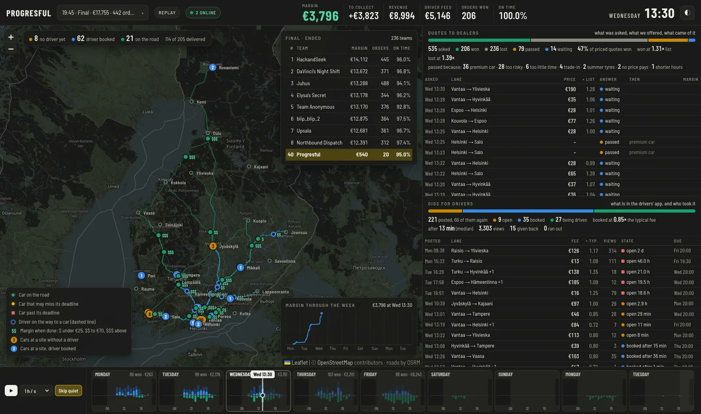

# Progresful Transfers


**It does not guess. It rehearses.**

A dispatcher for the Spread challenge by Bahn Express at Junction 2026. It runs a car
transport company in Finland for one simulated week: it quotes dealers against a
competitor, hires freelance drivers, and brings every car it wins to its deadline.
Before the week that counts, it played more than five thousand others.

Written in Go, with nothing but the standard library.

**Live board and replay: [bahn.pgf.lv](https://bahn.pgf.lv)**

## What the challenge asks, and our answer

| The challenge asks | Progresful Transfers answers |
|---|---|
| Quote every dealer, against a competitor | A market model per world and per dealer, learned from our own wins and losses. |
| Deliver at least 90 % on time | Every request gets a lateness risk. Above the cap we pass. 96.4 % on time on 48 worlds. |
| Move the cars with freelance drivers | Gigs with a fee that rises only as the deadline nears, and chains: one driver, two cars. |
| Earn the highest margin | €17,413 a week on 48 benchmark worlds, every one of the 48 weeks ranked. |
| Play the final live | The same code on a server, state saved every 2 seconds, a restart rejoins the week. |
| Be clear and robust for the jury | Go with no dependencies. Every request recorded, every version judged on the same worlds. |

## How the engine decides

1. **Quote.** Read the dealer's note for the real hours and the real deadline. The cost is
   1.2 times the typical driver fee. A lateness risk above the cap means we pass. The
   price is what this dealer accepts today.
2. **Dispatch.** The fee holds at the typical fee and rises to 1.25 times only near the
   deadline. Two orders become one gig when one driver can carry both, and a chain that
   found no driver gets a second attempt. A big dealer's car arrives the day it is ready.
3. **Learn.** Each win and each loss moves the price level, per dealer. An on-time guard
   tightens the cap before late cars show in the account. Friday is priced cheaper,
   because Saturday and Monday still deliver. Premium cars and trade-ins are declined.

The world is deterministic and every request is on tape, so any decision can be replayed,
questioned and improved.

## Seven decisions, measured on the same worlds

A change ships only if it beats the last version on the same worlds, week by week.

| Engine | Decision | Why | Effect |
|---|---|---|---|
| e2 | On-time protection | Most late cars were never booked before their last pickup. | Worst week 88.4 → 92.2 % on time |
| e9, e10 | One driver, two cars | Two orders on one route cost little more than one. | +€1,032 a week, 8 worlds |
| e15 | Market and risk models | The leaders won more orders and were more on time. | +€1,761 a week, 8 worlds |
| e18, e19 | A cheaper fee clock | Fees rose before the clock required it. | +€645 a week, 24 worlds |
| e20 | Discount and trust rush | Price in what a shared driver saves; keep big dealers' trust. | +€294 a week, 24 worlds |
| e21 | A second chain attempt | A chain that found no driver was dropped too early. | +€354 a week, 48 worlds |
| e22 | A cheaper Friday | No requests after Friday, yet Saturday and Monday deliver. | +€86 a week, 48 worlds, ± 30 |

## Results

- **€17,413** margin a week, the mean of 48 benchmark worlds, engine e22.
- **96.4 %** on time, with all 48 weeks above the 90 % minimum.
- **+37 %** margin a week from engine e8 to e22, on the same eight worlds.
- Ranking rounds: first at levels 5, 6 and 7, second at level 8.
- Live test final: top three, 98.9 % on time.

**Measured and rejected.** Trade-ins (47 % late, −€298 a week), a same-day price premium
(−€550 to −€900), higher fees to buy drivers (margin fell, on-time did not move), direct
offers to drivers (1 to 3 % accepted), a dearer price for small dealers (−€339), and many
more: [docs/ENGINE_LOG.md](docs/ENGINE_LOG.md) has every version and every rejected idea.

**Known limits.** Premium cars and trade-ins are declined, about 7 % of requests. The risk
model is fitted on our own practice weeks. New gains are near the noise floor (+€86 ± 30).
The weakest benchmark week is 92.5 % on time.

## The board



The board shows the week that is being played, live, and replays every logged week: cars
and drivers on real roads, the quotes to dealers, the gigs for drivers, and the margin
as it grows.

## Run it

```sh
scripts/build.sh                       # builds bin/hc, stamped with the hash of its source
echo 'SPREAD_KEY=<your team key>' > .env

bin/hc run -level 8 -seed spread-1     # one practice week
bin/hc bench                           # this engine on the fixed benchmark worlds
bin/hc replay runs/<run id>            # a logged week again, offline, from its tape
bin/hc ui                              # the board, on http://127.0.0.1:8790
bin/hc final                           # plays the live final
```

## Where things are

| Path | What |
|---|---|
| `cmd/hc` | The command line. |
| `internal/engine` | The decisions: quotes, gigs, fees, chains, risk. |
| `internal/runner` | Practice weeks and the live final. |
| `internal/api` | The Spread client; it records every request and answer. |
| `internal/notes` | The reader of dealer notes. |
| `internal/ui` | The board. |
| `docs/ENGINE_LOG.md` | Every engine version: what it does, what it was worth, what was rejected. |
| `deploy` | The units of the hosted runner and board. |

## Made by

Emīls Pļavenieks, Jurģis Kacēns and Krišjānis Mežulis of [Progresful](https://progresful.com).
Made with passion and sleepless nights.
